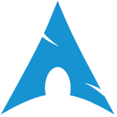
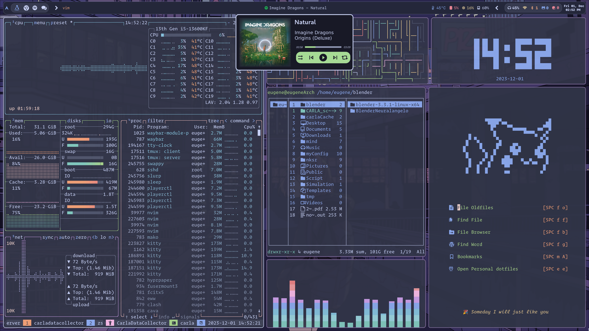
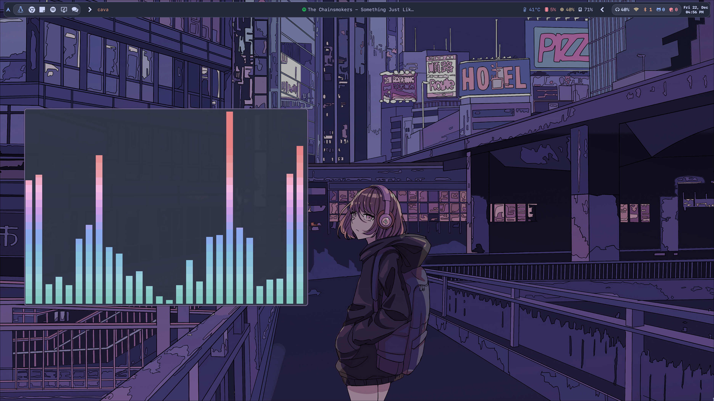
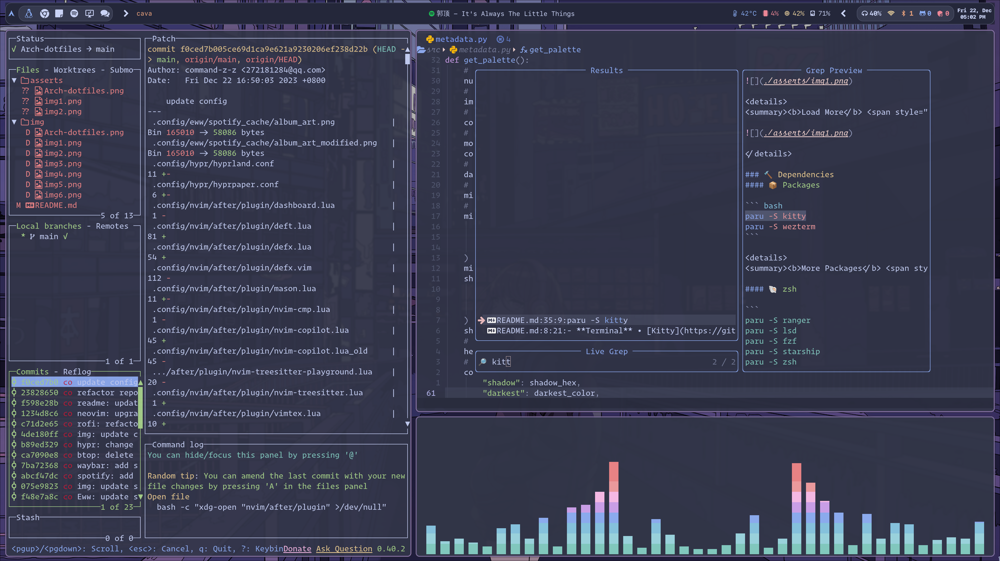

<h2>
 <b style="font-size:24px;line-height:24px;vertical-align:middle;"><i> Arch dotfiles</i></b>
</h2>

- **Window Manager** • [Hyprland](https://github.com/hyprwm/Hyprland)🎨 Tiles Manage!
- **Status Bar** • [Waybar](https://github.com/Alexays/Waybar)🧴 Highly customizable Wayland bar!
- **Widget System** • [Eww](https://github.com/elkowar/eww)🔔 ElKowars wacky widgets!
- **Terminal** • [Kitty](https://github.com/kovidgoyal/kitty) 💻 A powerful term with gpu support!
- **Shell** • [Zsh](https://www.zsh.org/) with Theme [Starship](https://github.com/starship/starship)🐚 Cross Shell Platform!
- **Application Launcher** • [Hyprlauncher](https://github.com/hyprwm/hyprlauncher) 🚀 An application launcher for Hyprland!
- **Notify Daemon** • [SwayNC](https://github.com/ErikReider/SwayNotificationCenter)📠 A simple GTK based notification daemon with modern UI!
- **File Manager** • [Ranger](https://github.com/ranger/ranger)📁 A VIM-inspired filemanager for the console!
- **File Manager GUI** • [Nemo](https://github.com/linuxmint/nemo)📂 File browser for Cinnamon!
- **Code Editor** • [Neovim](https://github.com/neovim/neovim)🗞️ My editor; configuration lives in [EugeneVim](https://github.com/command-z-z/EugeneVim).
- **Music Player** • [Spicetify](https://github.com/spicetify/spicetify-cli)🎹 A Customize Spotify client!
- **Audio Visualizer** • [Cava](https://github.com/karlstav/cava)🎼 Cross-platform Audio Visualizer!
- **Terminal Multiplexing** • [Tmux](https://github.com/tmux/tmux)🎯 A Terminal multiplexer!
- **Theme** • [Catppuccin](https://github.com/catppuccin/catppuccin)🌿 My favourite Theme!

### 🐜 Screenshots



<details>
<summary><b>Load More</b> <span style="font-size:14px;">(Click to expand) </span> </summary>




</details>

### 🔨 Dependencies

This is a personal Arch Linux / Hyprland setup. Install the dependencies for
those modules you choose to use; it is not a complete system installer.
The Hyprland entry point is [`.config/hypr/hyprland.lua`](.config/hypr/hyprland.lua),
which uses the Lua configuration API. Check compatibility with your installed
Hyprland version before loading it; the former `hyprland.conf` is in Git history.

| Component | Dependencies used by this configuration |
|---|---|
| Desktop session | Hyprland, Waybar, Eww, SwayNC, Kitty |
| Wallpaper, lock and idle | Hyprpaper, Hyprlock, Hypridle |
| Application launcher | Hyprlauncher |
| Music widgets | Playerctl (including `playerctld`), Python, PyGObject (`python-gobject` on Arch); the Eww adapters target Spotify |
| Region screenshots | Grim, Slurp, Swappy, wl-clipboard, libnotify (`notify-send`) |
| Volume shortcuts | Pamixer, libnotify, a working PulseAudio-compatible audio service |
| Appearance | Nerd Fonts and the `catppuccin-frappe-dark-cursors` cursor theme |

The startup block also invokes Fcitx5, Mihomo, `xrdb` (Arch package
`xorg-xrdb`) and a hardware-specific OpenRGB script. Install and configure
these if you want them, or remove their startup entries before using the profile.

<details>
<summary><b>Optional applications and personal tools</b></summary>

- **Shell and terminal tools:** Zsh, Oh My Zsh, Starship, Ranger, lsd, fzf,
  bat, btop, ripgrep, lazygit and Tmux. Ranger and Zsh plugins include Git
  submodules; clone recursively as shown below.
- **Music:** Spotify, Spicetify and Cava.
- **Applications bound to shortcuts:** Google Chrome, Neovim, QQ, WeChat,
  Spotify and Notion. Adjust the commands to match the applications you use.
- **Input method:** Fcitx5 and your preferred input-method engine.
- **Proxy:** Mihomo requires your own configuration.
- **Hardware lighting and cooler display:** OpenRGB and liquidctl. The startup
  script loads an OpenRGB profile named `white` and configures a Kraken LCD;
  these settings are specific to my hardware.
- **Additional widgets:** Widgex must be installed separately; see
  [Optional widgets](#-optional-widgets).

</details>

### 🛠️ Before you use

Review these settings before loading the full desktop configuration:

| Setting | Where to change it |
|---|---|
| Monitor names, resolution and rotation | The first `hl.monitor` entries in [hyprland.lua](.config/hypr/hyprland.lua). My setup uses `HDMI-A-1` at 2560×1440 with transform `3`, and `DP-1` at 3840×2160. Use `hyprctl monitors` in a running session to find your output names. |
| DPI and cursor size | The startup block sets `Xft.dpi: 192` and cursor size `48`; adjust these for your display. |
| Wallpaper and lock-screen image | [hyprpaper.conf](.config/hypr/hyprpaper.conf) and [hyprlock.conf](.config/hypr/hyprlock.conf) reference `~/myConfig/Arch-dotfiles/wallpaper/evening-sky.png`. Update the paths if you clone elsewhere, and the wallpaper monitor name for your display. |
| Keyboard and mouse | `kb_options = "caps:super"` maps Caps Lock to Super. G304 side buttons paste/copy; Kitty uses Ctrl+Shift+V/C. Review the bindings if you prefer different behavior. |
| Autostart and application workspaces | The startup block and window rules in `hyprland.lua` launch personal tools and assign applications to workspaces. |
| Hardware scripts | Review [scripts/](.config/hypr/scripts/) before enabling lighting or cooler controls. |

Hypridle locks after **10 minutes** of inactivity and turns displays off after
**15 minutes**, without suspending the computer.

### ⌨️ Keybindings

`Super` is normally the Windows key; this configuration also maps Caps Lock to Super.

| Shortcut | Action |
|---|---|
| Super + K | Open Kitty |
| Super + R | Open Ranger in Kitty |
| Super + V | Open Neovim in Kitty |
| Super + Space | Open Hyprlauncher |
| Super + B | Toggle Waybar visibility |
| Super + L | Lock the session |
| Super + D | Close the active window |
| Super + F | Toggle fullscreen |
| Super + T | Toggle floating |
| Super + 1–6 | Switch workspace |
| Alt + Shift + 1–6 | Move the window to a workspace and follow it |
| Super + Shift + H/J/K/L | Focus left/down/up/right |
| Super + Ctrl + H/J/K/L | Move the window left/down/up/right |
| Super + left/right mouse drag | Move/resize the window |
| Alt + Shift + 0 | Select a screenshot region, edit in Swappy and copy it |
| Super + M | Exit the Hyprland session |

See [hyprland.lua](.config/hypr/hyprland.lua) for application and media bindings.

### 🚀 Manual installation

1. Clone the repository and its plugin submodules:

   ```sh
   git clone --recursive https://github.com/command-z-z/Arch-dotfiles.git ~/myConfig/Arch-dotfiles
   ```

2. Choose the modules you want and install their dependencies. Review the
   machine-specific settings above before enabling the Hyprland configuration.

3. Back up the existing configuration, then copy or symlink each chosen module.
   For example, to try **only Kitty**, run the following in Bash or Zsh. The
   backup uses a unique directory and also preserves an existing symlink:

   ```sh
   mkdir -p "$HOME/.config"
   if [ -e "$HOME/.config/kitty" ] || [ -L "$HOME/.config/kitty" ]; then
       kitty_backup_dir=$(mktemp -d "$HOME/.config/kitty.backup.XXXXXX")
       mv "$HOME/.config/kitty" "$kitty_backup_dir/kitty"
       printf 'Previous Kitty config: %s/kitty\n' "$kitty_backup_dir"
   fi
   ln -s "$HOME/myConfig/Arch-dotfiles/.config/kitty" "$HOME/.config/kitty"
   ```

   A symlink means edits under `~/.config/kitty` also change this checkout.
   To use an independent copy, replace the final `ln -s` command with:

   ```sh
   cp -a "$HOME/myConfig/Arch-dotfiles/.config/kitty" "$HOME/.config/kitty"
   ```

4. Install fonts. The bundled `.config/font` directory is a source collection;
   copy it into the user font directory and refresh the font cache:

   ```sh
   mkdir -p "$HOME/.local/share/fonts"
   cp -R "$HOME/myConfig/Arch-dotfiles/.config/font/." "$HOME/.local/share/fonts/"
   fc-cache -f
   ```

   The collection includes Hack and JetBrains Mono Nerd Fonts. Some configs
   request other fonts: Kitty uses `Operator Mono Lig`, Waybar/SwayNC use
   `Liga SFMono Nerd Font`, and Hyprlock uses `Ubuntu Mono Nerd Font`.
   Install those separately or change the font settings to an installed family
   shown by `fc-list : family`.

5. Open a new Kitty window to check the theme and font. For the full desktop,
   place the selected configs under `~/.config/`, then validate the Hyprland
   configuration before starting a new session:

   ```sh
   Hyprland --verify-config -c "$HOME/.config/hypr/hyprland.lua"
   ```

   In a running Hyprland session, use `hyprctl configerrors` to inspect reported
   errors. Startup applications run when the compositor starts, not on reload;
   configuration validation alone does not verify that those applications work.

Keep the backup path if you want to revert: move your newly installed config
aside and restore the saved directory or symlink to its original location.

### 🧩 Optional widgets

The default Lua startup launches **Waybar, Eww and SwayNC**. The separate
[Widgex profile](.config/widgex/README.md) is started manually and includes a
top bar, clock/date, music dashboard, lyrics overlay, weather, memo, system
statistics, desktop pets and an agent monitor.

After installing Widgex and placing its configuration at `~/.config/widgex`,
try a single widget:

```sh
widgex check
widgex daemon start
widgex open clock
```

Use `widgex daemon stop` to stop it. See the
[profile README](.config/widgex/README.md) for the other commands and the
[agent monitor README](.config/widgex/widgets/agent-monitor/README.md) for its setup.
The screenshots above are not a dedicated preview of this optional profile.

Generated artwork, lyrics, Python bytecode and application state are excluded
from version control; the Eww fallback cover remains a tracked resource.

### 🔒 Archive

> [neovim](https://github.com/neovim/neovim) configuration has been removed from this repository, please refer to the my personal neovim repository [here](https://github.com/command-z-z/EugeneVim).

### ©️ Credits

Beauty community:[r/unixporn](https://www.reddit.com/r/unixporn/)

© repo:[command-z-z/dotfile](https://github.com/command-z-z/dotfiles)
© repo:[khaneliman/dotfile](https://github.com/khaneliman/dotfiles)
